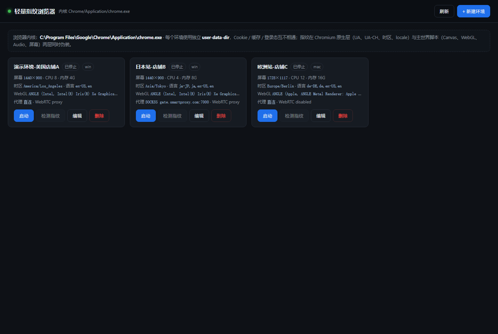

# 轻量指纹浏览器

一个**零依赖**的指纹浏览器（防关联浏览器）：每个"环境"有自己独立的 Cookie 存储、独立的指纹、独立的代理 IP。

不打包 Electron、不内嵌 Chromium —— 直接复用你机器上已有的 Chrome / Edge，整个项目只有 **约 4200 行代码（含测试）、零 npm 依赖**，目录 240 KB。



```
┌──────────────────────────────────────────┐
│  控制台（本地网页 http://127.0.0.1:xxxxx） │  ← 原生 JS，零构建
└────────────────┬─────────────────────────┘
                 │ HTTP JSON API
┌────────────────▼─────────────────────────┐
│  Node 服务（零依赖，只用内置模块）          │
│   · 环境存储   · 启动器                     │
│   · CDP 客户端（内置 WebSocket）            │
│   · 代理中继（http / socks5 + 认证）        │
└────────────────┬─────────────────────────┘
                 │ CDP + 独立 user-data-dir
┌────────────────▼─────────────────────────┐
│  本机 Chromium（你已装好的那个）            │
└──────────────────────────────────────────┘
```

## 快速开始

```bash
cd fingerprint-browser
node src/index.js
```

控制台会自动打开。点「新建环境」→ 填名称（其它可以点「随机一套」）→ 保存 → 「启动」。

要求：**Node 22+**（用到内置的全局 `WebSocket`）、本机装有 Chrome 或 Edge。
找不到浏览器时用环境变量指定：

```bash
FB_BROWSER="C:\Program Files\Google\Chrome\Application\chrome.exe" node src/index.js
```

命令行也能直接用：

```bash
node src/index.js list              # 列出所有环境
node src/index.js launch <环境ID>    # 直接启动某个环境
node src/index.js stop <环境ID>
node src/index.js stop-all
node src/index.js --port 8787       # 指定控制台端口
npm test                            # 跑冒烟测试（会真的启动两个浏览器）
```

## 它到底改了哪些指纹

分两层做，这是关键设计：

**第一层 · Chromium 原生层（CDP `Emulation` 指令）** —— 页面 JS 完全看不出被改过：

| 项 | 手段 |
|---|---|
| `User-Agent` 请求头 | `Emulation.setUserAgentOverride` |
| `Sec-CH-UA` / `Sec-CH-UA-Platform` 等 Client Hints | 同上，带完整的 `userAgentMetadata` |
| `navigator.platform` | 同上 |
| 时区（`Intl`、`Date`、`getTimezoneOffset`） | `Emulation.setTimezoneOverride` |
| Locale / `Intl` 默认语言 | `Emulation.setLocaleOverride` + `--lang` |

**第二层 · 主世界脚本（`document-start` 注入，所有 frame）** —— 补上 CDP 改不动的：

| 项 | 手段 |
|---|---|
| `hardwareConcurrency` / `deviceMemory` / `maxTouchPoints` | `Navigator.prototype` getter 重定义 |
| `screen.*` / `devicePixelRatio` | `Screen.prototype` / `window` getter 重定义；`outerWidth`/`outerHeight` **不伪造**（窗口本来就是按屏幕比例开的真实尺寸，钉成整屏反而会出现真窗口不可能有的 `outer - inner` 差值） |
| **Canvas** 指纹 | 24 个像素的定点 LSB 扰动，按环境 seed 确定性生成（同一环境每次一样，不同环境不一样） |
| **WebGL** 厂商/渲染器 | `getParameter` 覆写 37445/37446 及 VENDOR/RENDERER |
| **WebGL 能力值** | `MAX_TEXTURE_SIZE` / `MAX_CUBE_MAP_TEXTURE_SIZE` / `MAX_RENDERBUFFER_SIZE` / `MAX_VIEWPORT_DIMS` 按声明的 GPU 档位对齐，不让"渲染器写 RTX 4060、能力值却是软渲染的 8192" |
| **Audio** 指纹 | `getChannelData` 与 `copyFromChannel` 加同一套 1e-7 级噪声（按采样序号算，两个 API 读到的偏移一致）、`AnalyserNode` 加噪 |
| 字体测量 | `measureText().width` ±0.01px 确定性偏移 |
| **字体列表** | `document.fonts.check()` 按声明平台的白名单过滤 + `measureText` 对未知字体回退到 Arial/Helvetica：Windows 上跑 macOS 指纹时查不到微软雅黑/宋体这一套 |
| **WebRTC** IP 泄漏 | 三种模式：跟随代理改写候选 / 禁用候选 / 不处理；候选地址按环境 seed 派生（不是全网一个 `192.168.1.88`），`toJSON()` 一并覆盖（否则 `JSON.stringify(pc.localDescription)` 是现成的绕过口）；外加 `--force-webrtc-ip-handling-policy=disable_non_proxied_udp` |
| `navigator.webdriver` | 启动参数 + getter 双保险 |
| 元素坐标（可选，默认关） | `getBoundingClientRect` 亚像素偏移 |

所有补丁函数都会重写 `Function.prototype.toString`，让它们看起来是 `[native code]`。

幂等性放在 **Node 侧**（同一个 target 只注入一次脚本），页面里**不留任何标记**。这一点很关键：以前那种 `window[Symbol.for('fb.'+seed)]` 的守卫，`Object.getOwnPropertySymbols(window)` 一行就能枚举出来，等于主动告诉站点"这个浏览器被改过"。

**环境隔离**：每个环境一个独立 `--user-data-dir`（`data/profiles/<id>/`），Cookie、localStorage、IndexedDB、缓存、登录态完全隔开，互不可见。

## 关于「设备码」

先分清两件事，这是最容易混的地方。

### 1. 真正的设备码，浏览器读不到

MAC 地址、主板/硬盘序列号、CPU ID、Windows `MachineGuid`、SMBIOS UUID —— **网页 JS 一条都拿不到**，Web 平台压根没提供这些 API，这是浏览器的安全边界。

所以「浏览器会记住设备码吗」这个问题的答案是：**浏览器不读取、也不存储这些**。能读到它们的只有**原生程序**（客户端软件、驱动、本地服务）——某些网银安全控件、游戏反作弊、企业内网客户端属于这一类，它们是在操作系统层读，不是浏览器读。

也因此「伪装 MAC 地址」这件事，改浏览器没有意义：网页侧根本拿不到它。要对付读 MAC 的客户端，得在 OS / 驱动 / 虚拟化层做。

### 2. 网页侧真实存在的「准设备码」

我在这台机器上用真实 Chrome 实测了一遍（`node test/device-audit.js` 可复现）：

| 标识 | 实测结果 | 能否区分设备 | 本项目处理 |
|---|---|---|---|
| `navigator.gpu` → `adapter.info.vendor/architecture` | `intel / gen-9`，而 WebGL 同时报告 NVIDIA 4060 | **能，硬件家族，还自相矛盾** | ✅ 已伪装成与 WebGL 声明一致 |
| `speechSynthesis.getVoices()` | 22 个，含 `Microsoft Huihui / Kangkang / Yaoyao` | **能，直接区分操作系统** | ✅ 已按声明平台替换 |
| `enumerateDevices()` 的 `deviceId` | **空字符串**（Chrome 157 未授权时） | 否（官方已收紧） | 无需处理 |
| Client Hints 高熵值（`architecture` / `platformVersion`） | `x86` / `15.0.0` | 能 | ✅ CDP 原生层已控 |
| `performance.memory.jsHeapSizeLimit` | 约 4.1 GB | 弱（上限固定） | 未处理 |
| `AudioContext.sampleRate` / `maxChannelCount` | 48000 / 2 | 弱（现代机器几乎一样） | 未处理 |
| WebGL `MAX_TEXTURE_SIZE` / `MAX_VIEWPORT_DIMS` | 16384 / 32767 | 中（GPU 档位） | 未处理，但所声明 GPU 档位下本就如此 |
| `storage.estimate().quota` | 10 GB，随磁盘剩余空间变 | 弱 | 未处理 |
| **TLS / HTTP2 指纹（JA3/JA4）** | JS 读不到，但**服务端看得到** | **最强** | ❌ 改不了，需要改内核 |

### 3. 结论

真正有效的「设备码伪装」不是伪造一个假 MAC（伪不着，也不需要），而是两件事：

1. **堵住旁路泄露** —— 上面表格里那两个「能」的，就是实测找出来的口子。
2. **让所有信号自洽** —— 声明 NVIDIA 就不能同时报 intel，声明 macOS 就不能留着 Windows 的语音包。

还有一个实际经验：**同一台机器上的多个环境，硬件层信号天然是共享的**（CPU 核数范围、GPU 家族、字体集、音频设备就那么几种）。所以 20 个环境别配成 20 种完全不同的硬件——真实的多账号运营应该是**少数几种硬件配置轮换**，这反而更不容易被聚类。设备级的一致性比"每个都独一无二"更重要。

## TLS 指纹是什么

你在网页里改的一切（UA、Canvas、时区）都发生在 **TLS 之后** —— 加密通道建立之后。而 TLS 握手的第一包 `ClientHello` 是**明文**的，服务端在你连一个 HTTP 请求都还没发出之前，就已经看到了：

- TLS 版本、支持的版本
- **密码套件列表**（16 个还是 52 个，什么顺序）
- **扩展列表**（18 个还是 11 个，什么顺序）
- 椭圆曲线列表、签名算法列表
- ALPN（`h2` / `http/1.1`）
- 几个 GREASE 随机填充值

这些由客户端**用的哪个 TLS 库、哪个版本**决定，跟你 UA 声称什么无关。串起来哈希就是 JA3 / JA4。

`node test/tls-audit.js` 能在本机截获真实 ClientHello 并解析（不用联网，裸 TCP 抓明文）。实测三种客户端：

| 客户端 | JA4 | 解码 |
|---|---|---|
| 本项目启动的 Chrome | `t13i1516h2_8daaf6152771_6a554d0749f7` | TLS1.3，15 个套件，16 个扩展，ALPN=h2 |
| Node.js `tls` | `t13d521100_b262b3658495_647b77eacc22` | TLS1.3，**52 个套件**，11 个扩展，**无 ALPN** |
| curl | `t12i2107h1_76e208dd3e22_6c134f388a40` | **TLS1.2**，21 个套件，7 个扩展 |

（JA4 前缀里的 `i`/`d` 是 SNI：这次按 IP 连接所以是 `i`，按域名访问会是 `d`。）

结论：**用 Chrome 还是用 Node/curl 发请求，服务端一眼就能分开**，哪怕你把 User-Agent 写得一模一样。

### 一个有意思的现象：JA3 会"漂移"

同一个 Chrome，连续三次连接的 JA3 分别是 `2d4a27d5…`、`3a2693ba…`、`ec5199e2…` —— 每次都变。但 JA4 三次完全一致。

不是抓包错了：**Chrome 会故意打乱 ClientHello 里扩展的顺序**来对抗"按顺序哈希"的 JA3。所以现代风控系统用 JA4（先排序再哈希）。这个坑我第一版脚本就踩了，顺带也踩了 GREASE 要剔除。

### 为什么改不了

- 它在 TLS 层，网页 JS 完全够不到
- 代理 / VPN 也改不了 —— 它们只是转发加密字节流，TLS 是端到端的
- 要换就得改 BoringSSL 里 ClientHello 的构造，那是编译进内核的

对**非浏览器**的请求（爬虫、脚本）有解：`curl-impersonate` / `uTLS` / `curl_cffi` 这类库专门模仿 Chrome 的 ClientHello。

对浏览器无解，除了改内核源码（商业指纹浏览器的做法）。

### 而这恰好是本项目的优势

我们**复用真 Chrome**，TLS 指纹天然就是真 Chrome 的，而且和 UA 声明的版本**永远一致**。反而是自带改过内核的商业方案，一旦内核版本和声称的 UA 对不上，就会出现"TLS 是 Chrome 141、UA 说自己是 157"这种硬伤。

### UA 这一步比想象的细：版本号必须"看起来不完整"

真 Chrome 从 110 起做了 **UA reduction**：请求头里只有 `Chrome/156.0.0.0`，完整版本号 `156.0.8078.80` 只出现在 UA-CH（`uaFullVersion`）里。所以"用完整版本号拼 UA"看着更精确，实际是**一眼就能筛出来的特征**——真机不会那么发。

同理，`sec-ch-ua` 里那个 GREASE 品牌名、版本、以及**顺序**（Chrome 156 是 `"Not:A-Brand";v="8", "Chromium";v="156", "Google Chrome";v="156"`）每个版本都在变，手拼必然过时。所以本项目**不自己拼**：启动时开一个后台标签页请求本地探针，把浏览器自己发的请求头和 `getHighEntropyValues()` 读回来，缓存到 `data/client-hints.json`，之后只替换平台相关字段（`platform` / `platformVersion` / 架构）。这样在 Windows 上跑 Windows 指纹时，服务端看到的 UA、`sec-ch-ua`、`accept-language` 与真机**逐字节一致**；换成 macOS 指纹时只换平台段。

代价是每个 Chrome 版本第一次启动会多一个一闪而过的后台标签页。

## 关于代理（这是能做多账号的关键）

Chrome 的 `--proxy-server` **不支持带账号密码**，而住宅代理基本都要认证。所以项目内置了一个本地代理中继：

```
Chrome ──(无认证, 127.0.0.1)──▶ 本地中继 ──(带 Proxy-Authorization / SOCKS5 认证)──▶ 你的上游代理 ──▶ 互联网
```

- 支持 `HTTP/HTTPS` 与 `SOCKS5` 上游，都支持用户名密码
- 账号密码只在本机内存里，不写进 Chrome 命令行，也不落到环境的 user-data-dir 里
- 认证失败会直接拒绝连接，**不会静默降级成直连**（这是很多简易方案的翻车点）

## 为什么这么轻

| | 商业指纹浏览器（AdsPower / 比特 等） | 本项目 |
|---|---|---|
| 体积 | 300 MB ~ 1 GB | < 200 KB（不含浏览器） |
| 内核 | 自带改过的 Chromium | 复用你已装的 Chrome |
| 运行时 | Electron | Node（甚至不用装依赖） |
| 启动 | 双击 exe | `node src/index.js` |

代价是：它**不是**改内核的方案，所以下面这些改不了（见下节）。

## 诚实的边界

**能做到的**：绕过绝大多数基于 JS 的指纹采集 —— Canvas / WebGL（含能力值）/ Audio / 字体列表 / 屏幕 / CPU 内存 / 时区 / 语言 / UA-CH 的一致性伪装。

**做不到的**（需要改 Chromium C++ 源码，属于另一个工程量级）：

- **TLS 指纹（JA3/JA4）与 HTTP/2 指纹** —— 这由内核决定，JS 和 CDP 都改不了。想对付高强度风控，还是要用真改过内核的方案。
- **GPU 的真实深度指纹** —— WebGL 的 `RENDERER` 字符串和能力值能改，但驱动层面的细节（着色器精度、抗锯齿行为）仍可能与声明不一致。
- **用 CSS 量字宽的字体探测** —— `document.fonts.check()` 和 canvas `measureText()` 已经按白名单过滤，但"给 span 设字体再看 `offsetWidth`"这种纯 DOM 测法绕过补丁，需要在 CSSOM 层改写（没做）。
- **同一台机器上的多个环境仍共用同一个出口网卡** —— 必须自己配不同代理 IP 才算真正隔离。

**建议**：同一台机器上，一个环境配一个独立代理 IP，选择与指纹自洽的时区/语言（美国 IP 就别配 Asia/Tokyo 时区）。配好之后点卡片上的「测代理」，直接看出口 IP 和国家——如果出口和直连一样，说明代理没生效。

## 环境管理

- **克隆**：一键复制配置，但会换一个新 seed（Canvas/Audio 噪声和 WebRTC 假 IP 跟着变）；Cookie 不复制，等于"同一台机器的另一台"。
- **导出 / 导入**：`/api/export` 输出可迁移的 JSON，**不含代理密码**（密码只写不读），导入后密码留空需要重新填。
- **搜索 / 分组**：顶部搜索框按名称、分组、代理、时区过滤；拖动下拉框按分组筛选。分组在编辑器里填。
- **测代理**：卡片上的「测代理」会经本地中继真实请求一次 `ipinfo.io`（被限流时自动退到 `ip-api.com`），显示出口 IP、国家/城市、运营商、耗时，并和直连 IP 对比判断是否"假代理"。

## 目录结构

```
fingerprint-browser/
├── src/
│   ├── index.js        CLI 入口（控制台 / launch / stop / list）
│   ├── server.js       零依赖 HTTP 服务 + JSON API + 静态资源
│   ├── store.js        环境配置存储、随机指纹素材池
│   ├── launch.js       启动器：拉起 Chromium、CDP 接管、覆写、注入
│   ├── cdp.js          极简 CDP 客户端（内置 WebSocket，支持 flatten session）
│   ├── proxy.js        本地代理中继（http / socks5 上游 + 认证）
│   ├── browser.js      发现本机 Chromium（Chrome / Edge / Playwright 自带）
│   └── fp/patch.js     主世界指纹补丁（被当纯文本注入，用 __CFG__ 占位）
├── public/             控制台前端（原生 JS，无构建）
├── test/smoke.js       冒烟测试：静态自检 + 代理 + 真实启动读指纹
└── data/               运行时生成：profiles.json、instances.json、client-hints.json、
                        各环境 user-data-dir、日志（路径可用 FB_DATA 覆盖）
```

## 常用操作

- **看某个环境真实的指纹**：卡片上的「检测指纹」——它会在该环境里开一个临时标签页（`127.0.0.1`，安全上下文，这样 `deviceMemory` 等才会存在）读一遍指纹再关掉。
- **多开**：直接再点另一个环境的「启动」，互相独立。
- **排查启动失败**：看 `data/logs/<环境id>.log`（Chrome 自己的 stderr）。
- **重置某个环境**：删掉后重建（等于换了新机器）。
- **控制台崩了/重启了**：浏览器进程是独立起来的（`detached`），控制台下次启动会按 `data/instances.json` + `DevToolsActivePort` 自动**接管**回来，卡片直接显示「运行中」，代理中继也会在原端口上重新拉起来。不用手动去任务管理器里杀残留。
- **换数据目录**：`FB_DATA=D:\fb-data node src/index.js`，测试脚本默认就写临时目录，不会碰你的环境。
- **数据损坏**：`profiles.json` 解析失败时会先备份成 `profiles.json.corrupt-<时间戳>` 再放空库，不会把你所有环境覆盖掉。

## 合规

这是一个浏览器环境隔离与隐私保护工具。请只用于你自己拥有或已获授权的账号与环境，遵守目标平台的服务条款与所在地法律。用于虚假注册、欺诈、刷单等行为与作者无关。
